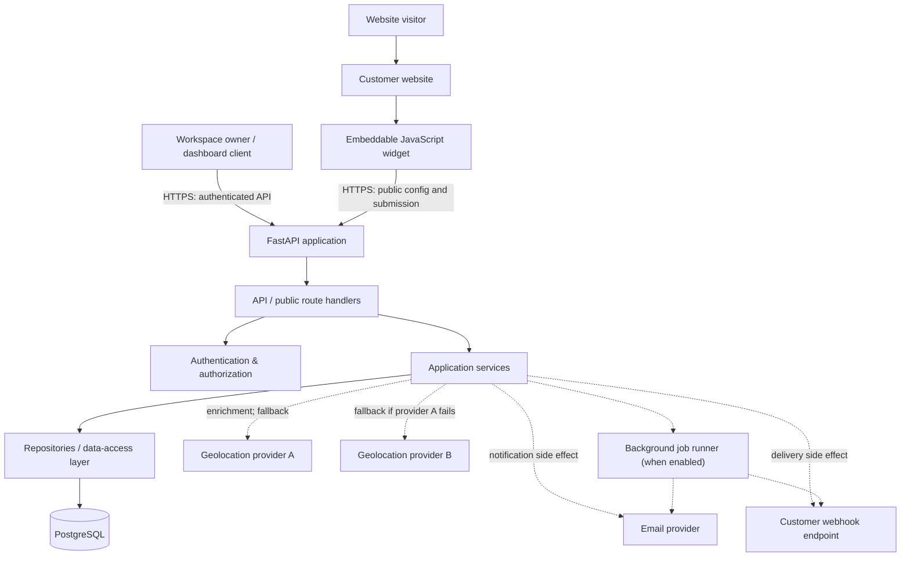

# System Architecture

## 1. Purpose

This document describes the architecture of the **Lead-Capture Platform**: a backend service that lets a workspace create and configure embeddable lead-capture widgets, publish them on external websites, receive submissions, and review captured leads through an authenticated API.

It records the intended initial architecture and separates core responsibilities so the implementation can evolve without coupling the public widget, business rules, persistence, and external providers together.

> **Implementation status:** This document is the architectural baseline. Components or integrations described as optional or planned must not be treated as implemented until the code and tests confirm them.

## 2. System overview

The platform has two primary request paths:

1. **Owner/dashboard path:** an authenticated workspace user manages widgets and reads submissions or analytics.
2. **Public widget path:** a visitor loads a widget from a customer's website and submits their information without having a platform account.

Both paths use the same backend application and persistent database, but have different trust levels and authorization rules.



Solid arrows represent the main request and persistence path. Dashed arrows represent integrations or asynchronous work whose exact implementation depends on the deployed version. Provider calls must not be allowed to compromise the core submission-persistence guarantee.

## 3. Major components and responsibilities

| Component | Responsibility | Must not own |
|---|---|---|
| Dashboard/client | Presents workspace management, submissions and analytics UI; sends authenticated API requests | Authorization decisions or database access |
| Customer website | Hosts the embed snippet and widget | Platform secrets or privileged API credentials |
| JavaScript widget | Loads public configuration, renders the form, performs client-side usability checks, and sends submissions | Trusted validation, tenant authorization, or abuse-control decisions |
| FastAPI route handlers | Parse HTTP requests, validate request shape, apply endpoint-level dependencies, and serialize responses | Complex business workflows or direct provider-specific logic |
| Authentication/authorization | Identifies the caller and checks workspace/resource access | Widget business logic or response rendering |
| Application services | Coordinate use cases and enforce business rules; orchestrate validation, persistence and integrations | HTTP-specific response formatting |
| Repositories/data-access layer | Encapsulate database queries and persistence operations | HTTP concerns, authentication tokens, or external notification delivery |
| Domain/data models | Represent entities, relationships, and constraints used by the application | Request handling or orchestration |
| PostgreSQL | Durable storage for workspaces, users, widgets, submissions and related records | External side effects |
| Integration adapters | Encapsulate geolocation, email and webhook provider-specific requests, timeouts and error mapping | Core business rules |
| Background job runner (if enabled) | Performs slow/retryable side effects outside the request path | Becoming the only record that a submission exists |

### 3.1 Backend layering

The intended dependency direction is:

```text
HTTP routes / API handlers
          |
          v
Application services
          |
          v
Domain rules and repository interfaces
          |
          v
Persistence adapters / PostgreSQL

Application services ---> External integration adapters
```

- **Routes** are thin. They translate HTTP input into application calls and translate results into HTTP responses.
- **Services** coordinate use cases, enforce business rules, and define transaction boundaries.
- **Repositories** provide explicit data-access operations. They prevent business logic from spreading across route handlers.
- **Models** describe domain entities and/or database mappings. Keep API request/response schemas distinct from persistence models where that improves safety and clarity.
- **Integration adapters** isolate third-party SDKs and response formats so providers can be replaced or mocked in tests.

A lower layer must not import or depend on a higher layer. In particular, repositories should not depend on FastAPI request objects, and domain logic should not depend on provider SDKs.

## 4. Request paths

### 4.1 Authenticated workspace operations

Examples include creating a widget, updating its configuration, listing submissions, and reading analytics.

1. The client sends an HTTPS request with its authentication credentials.
2. The route handler validates the request schema and resolves the caller's identity.
3. Authorization checks that the caller may access the requested workspace and resource.
4. The application service applies business rules.
5. The repository reads or writes records in PostgreSQL, using workspace-scoped queries and constraints where appropriate.
6. The route returns a documented response and status code.

**Tenant isolation is mandatory:** a workspace user must not be able to read, change, or delete another workspace's widgets or submissions by guessing or supplying an identifier. Authorization must be enforced server-side for every protected resource, not only in the UI.

### 4.2 Widget delivery and configuration

1. A visitor opens a customer website containing the embed snippet.
2. The browser loads the platform's versioned JavaScript asset.
3. The widget requests the public configuration associated with its public widget identifier.
4. The backend returns only configuration intended to be public, such as enabled fields, labels, and presentation options.
5. The widget renders the form.

The public configuration endpoint must not return private workspace data, secrets, internal database identifiers that are not needed by the client, or privileged management settings. Public widget identifiers are identifiers, not authorization credentials.

Versioned assets and stable configuration responses may use HTTP caching. Cache headers, validators, TTLs and invalidation behavior must be documented alongside the widget contract. Changes to a widget must not leave stale configuration cached beyond the intended policy.

### 4.3 Public submission

1. The browser submits the form to the public submission endpoint over HTTPS.
2. The route applies request-size limits and validates the payload shape.
3. The backend resolves the widget and verifies that it is enabled and eligible to accept submissions.
4. Abuse controls run, including rate limiting and spam checks.
5. The service normalizes and validates the submitted fields against the widget's allowed configuration.
6. The submission is persisted in PostgreSQL. Persistence is the primary success condition.
7. Optional enrichment and notifications are attempted synchronously or scheduled for background processing, according to the implementation.
8. The API returns a stable response with a submission identifier or a documented error.

Client-side validation improves usability but is not a security boundary. All important validation and abuse controls must be enforced by the backend.

**Failure policy:** failure of an optional geolocation provider, email provider, or webhook must not erase a stored submission or turn a successful persistence operation into a failed submission response. The exact retry and reporting behavior depends on whether the integration runs synchronously or through a background job.

### 4.4 External integration behavior

- **Geolocation:** use provider A first and provider B as fallback if provider A fails or cannot produce a usable result. If both fail, preserve the submission and continue without enrichment. Set timeouts and avoid sending unnecessary personal data.
- **Email:** treat notification delivery as a side effect, not the source of truth for whether a submission was captured. Record failures and retry only according to the implemented delivery policy.
- **Webhooks:** deliver only the agreed payload to configured customer endpoints. Apply timeouts, bounded retries and appropriate protections against SSRF and unsafe destinations before enabling arbitrary webhook URLs.
- **Background processing:** when slow or retryable work is moved off the request path, define job persistence, retry/backoff, idempotency, terminal failure handling and operational visibility. Do not claim durable delivery if jobs exist only in process memory.

These are architectural requirements; provider names, queue technology and exact retry settings are implementation decisions that should be recorded once selected.

## 5. Trust boundaries

The platform crosses several trust boundaries:

1. **External browser to public API:** all incoming fields, headers, origins and request rates are untrusted.
2. **Customer website to widget script:** the hosting page is outside the platform's control; the widget must not assume that the page or its JavaScript environment is trustworthy.
3. **Authenticated client to workspace API:** authentication identifies a caller, but every resource access still requires authorization and tenant scoping.
4. **Application to database:** use parameterized queries/ORM operations, least-privilege credentials, migrations, constraints and restricted network access.
5. **Application to external providers:** provider responses may be slow, unavailable, malformed or unexpected; apply timeouts and validate responses.
6. **Application to customer webhook endpoints:** destinations and responses may be hostile. Validate destination policy and protect against server-side request forgery before supporting user-configurable URLs.
7. **Logs and operational telemetry:** request bodies, contact details, secrets and authentication tokens must not be logged indiscriminately.

### 5.1 Security principles

- Use HTTPS outside local development.
- Keep secrets in environment-based configuration or a secret manager, never in widget configuration or committed source.
- Enforce workspace ownership in the backend and in database queries.
- Validate and bound public request payloads.
- Apply rate limits and spam prevention to public submission routes.
- Configure CORS narrowly enough for the intended widget behavior; CORS is not authentication and does not stop non-browser clients.
- Set explicit timeouts for external calls.
- Minimize personal data sent to enrichment and notification providers.
- Return stable, non-sensitive error responses; keep diagnostic details in appropriately redacted server logs.
- Make duplicate handling and retries safe where supported.

## 6. Persistence and consistency

PostgreSQL is the intended durable source of truth for workspaces, widgets and captured submissions.

- Database migrations are the authoritative evolution path for the schema.
- Foreign keys and unique constraints should enforce relationships and invariants that must hold under concurrent requests.
- Queries for protected resources must be scoped to the authorized workspace.
- Submission creation should have a clearly defined transaction boundary.
- Optional side effects should not be treated as proof that the submission exists.
- If reliable asynchronous delivery is required, use a durable job/outbox design rather than relying only on in-process background tasks.
- Use idempotency keys or a documented duplicate-detection strategy where clients may safely retry submission requests.

The exact table structure and index choices belong in `database_schema.md`; entity meanings and business invariants belong in `domain_models.md`.

## 7. Configuration and deployment boundaries

The application should obtain environment-specific values from validated configuration, including the database connection, authentication settings, allowed origins, provider credentials, timeout settings, rate-limit settings and public base URL where needed.

- `.env.example` should list variable names and safe example values, never real credentials.
- Startup should fail clearly when required configuration is missing or invalid.
- Secrets must not be embedded in frontend assets or public widget configuration.
- Local development may use Docker Compose for the API and PostgreSQL.
- Production topology, managed services, TLS termination, queue technology and deployment platform are deployment decisions and must be documented separately when selected.

## 8. Observability and health

The architecture should support enough observability to diagnose failures without exposing sensitive lead data.

- **Liveness:** indicates whether the application process is running.
- **Readiness:** indicates whether the application is ready to serve requests, including required dependency checks as defined by the implementation.
- **Structured logs:** include request/correlation IDs, route, outcome, latency and safe error context.
- **Metrics:** track request volume and latency, validation failures, rate-limit responses, persistence failures, provider fallback/failure rates, and background-job outcomes where available.
- **Sensitive data:** avoid logging raw submission bodies, credentials, tokens or unnecessary personal information.

Metrics, tracing and alerting can be introduced incrementally; documentation must distinguish configured telemetry from future intentions.

## 9. Architecture decisions and boundaries

The initial design favors a **modular monolith**: one deployable FastAPI application with clear internal layers and modules. This keeps the first version straightforward to develop and test while preserving boundaries that allow individual components to evolve later.

Do not split the system into microservices or introduce a distributed queue, cache, or orchestration platform without a concrete requirement. First establish correct tenant isolation, durable persistence, validation, abuse protection, failure handling and test coverage.

Decisions that should be recorded separately when finalized include:

- Authentication mechanism and workspace membership model
- ORM and repository conventions
- Idempotency and duplicate-detection policy
- Rate-limit storage and behavior during limiter failure
- Background-job mechanism and durability guarantees
- Geolocation provider selection and fallback conditions
- Email/webhook delivery and retry policy
- Widget asset caching and configuration invalidation
- Data retention and deletion behavior

## 10. Related documentation

- [`domain_models.md`](domain_models.md) — entities, relationships and business rules
- [`database_schema.md`](database_schema.md) — actual database tables, constraints and indexes
- [`api_contracts.md`](api_contracts.md) — authenticated API request/response contracts
- [`widget_contract.md`](widget_contract.md) — embed snippet, public configuration and browser-facing contract
- [`submission_flow.md`](submission_flow.md) — detailed submission sequence and failure behavior
- [`security_spec.md`](security_spec.md) — security threats and implemented controls
- [`event_spec.md`](event_spec.md) — asynchronous event/job contracts, if applicable

---

## Maintenance rule

Update this document when the system's component boundaries, request paths, trust boundaries or integration behavior changes. Keep it aligned with the code and tests. If an architectural feature is only planned, label it as planned until the implementation is verified.
