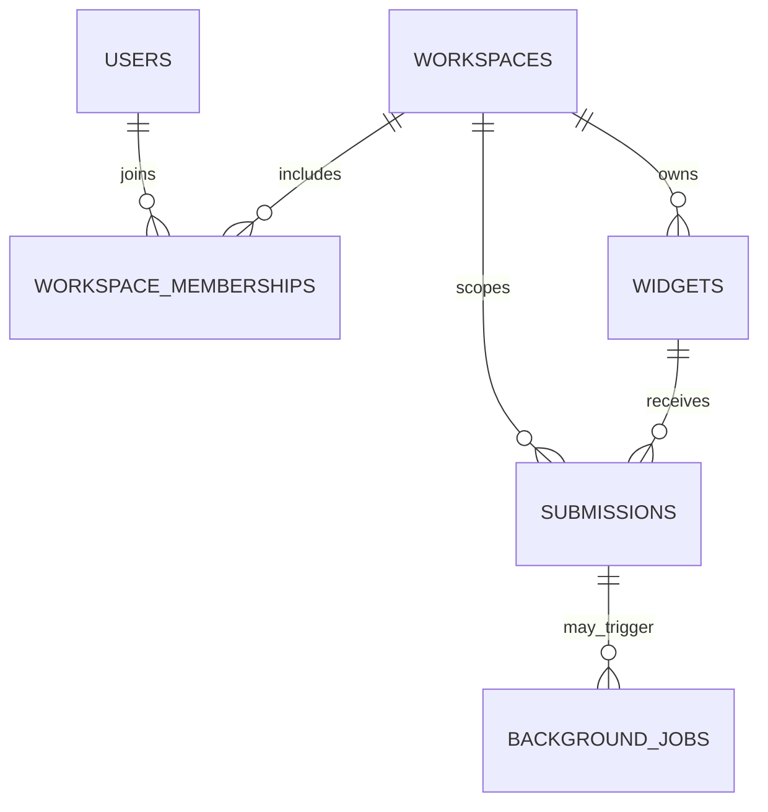

# Database Schema

## 1. Purpose and status

This document defines the proposed PostgreSQL persistence model for the **Lead-Capture Platform**. It translates the domain concepts in `domain_models.md` into tables, columns, relationships, constraints, indexes, and migration rules.

> **Important — schema status:** The application schema has not been verified against existing SQLAlchemy models or Alembic migrations in this drafting step. The definitions below are the recommended initial schema baseline, not proof that these tables already exist. Once implementation begins, the SQLAlchemy models and committed Alembic migrations are authoritative; update this document to match them exactly.

## 2. Design principles

- PostgreSQL is the durable source of truth for workspaces, widgets and accepted submissions.
- Every tenant-owned record must have an explicit and enforceable ownership path.
- Use database constraints for invariants that must remain true under concurrent requests.
- Use foreign keys rather than relying only on application-level assumptions.
- Keep public widget identifiers distinct in meaning from internal management identifiers.
- Store structured lead fields in `JSONB` initially, while enforcing field allowlists and payload limits in the application.
- Add indexes for real query patterns, especially workspace-scoped dashboard queries.
- Use Alembic migrations for every schema change; do not rely on automatic table creation in production.
- Do not add tables for optional features until their behavior and operational requirements are decided.

## 3. Initial table overview

| Table | Purpose | Status in this proposal |
|---|---|---|
| `users` | Authenticated platform users | Core |
| `workspaces` | Tenant and ownership boundary | Core |
| `workspace_memberships` | Maps users to workspaces and roles | Recommended if workspace collaboration is supported |
| `widgets` | Widget configuration and lifecycle | Core |
| `submissions` | Durable captured lead data | Core |
| `idempotency_records` | Recognizes safe retries, if idempotency is implemented | Optional |
| `background_jobs` | Durable tracking of asynchronous work, if a database-backed job mechanism is selected | Optional |

The proposal assumes users can belong to multiple workspaces. If the first implementation deliberately uses one workspace per user, that decision may simplify the membership model, but the ownership and tenant-isolation guarantees must remain the same.

## 4. Tables and columns

The SQL types below are PostgreSQL types. `UUID`, `JSONB`, and `TIMESTAMPTZ` are recommended defaults; the final SQLAlchemy models and migrations must define the actual types and defaults.

### 4.1 `users`

Stores platform user identities. Authentication-specific credential storage depends on the chosen authentication mechanism.

| Column | Type | Nullable | Default / rule | Notes |
|---|---|---:|---|---|
| `id` | `UUID` | No | Generated by application or database | Primary key |
| `email` | `VARCHAR(320)` | No | Normalize before storing | Unique login identifier if email login is selected |
| `display_name` | `VARCHAR(120)` | Yes | — | Human-readable name |
| `password_hash` | `TEXT` | Yes | — | Only if password-based authentication is selected; never store plaintext passwords |
| `status` | `VARCHAR(20)` | No | `active` | Suggested values: `active`, `disabled` |
| `created_at` | `TIMESTAMPTZ` | No | `now()` | Server-generated creation time |
| `updated_at` | `TIMESTAMPTZ` | No | `now()` | Update on mutation |

**Constraints and indexes**
- Primary key: `id`.
- Unique index on normalized `email` if email is the login identifier.
- Check constraint for supported `status` values, if status is represented as text.
- Do not include password hashes or authentication secrets in ordinary user response schemas.

### 4.2 `workspaces`

Represents a tenant.

| Column | Type | Nullable | Default / rule | Notes |
|---|---|---:|---|---|
| `id` | `UUID` | No | Generated by application or database | Primary key |
| `name` | `VARCHAR(160)` | No | Trimmed, non-empty | Workspace display name |
| `status` | `VARCHAR(20)` | No | `active` | Suggested values: `active`, `suspended`, `deleted` if soft deletion is supported |
| `created_at` | `TIMESTAMPTZ` | No | `now()` | Server-generated creation time |
| `updated_at` | `TIMESTAMPTZ` | No | `now()` | Update on mutation |

**Constraints and indexes**
- Primary key: `id`.
- Check constraint for supported `status` values if status is text.
- Add a name index only if there is a demonstrated lookup requirement; names usually do not need to be globally unique.

### 4.3 `workspace_memberships` (recommended)

Maps users to workspaces and assigns a role. Include this table if more than one user may access a workspace or one user may access multiple workspaces.

| Column | Type | Nullable | Default / rule | Notes |
|---|---|---:|---|---|
| `workspace_id` | `UUID` | No | — | FK to `workspaces.id` |
| `user_id` | `UUID` | No | — | FK to `users.id` |
| `role` | `VARCHAR(20)` | No | `member` | Suggested values: `owner`, `admin`, `member` |
| `created_at` | `TIMESTAMPTZ` | No | `now()` | Membership creation time |

**Constraints and indexes**
- Composite primary key: (`workspace_id`, `user_id`).
- Foreign keys to `workspaces.id` and `users.id`.
- Check constraint for allowed roles.
- Index on (`user_id`, `workspace_id`) if user-to-workspace lookup is common and the primary-key order does not serve it efficiently.
- Business rule: authorization must check membership and role on every protected operation.

If the application uses a simpler single-owner model, document that alternative and enforce the owner relationship explicitly instead of keeping an unused membership table.

### 4.4 `widgets`

Stores widget ownership, public identity, configuration and lifecycle state.

| Column | Type | Nullable | Default / rule | Notes |
|---|---|---:|---|---|
| `id` | `UUID` | No | Generated by application or database | Internal primary key |
| `public_id` | `UUID` | No | Independently generated | Public lookup identifier; not an access credential |
| `workspace_id` | `UUID` | No | — | FK to `workspaces.id` |
| `name` | `VARCHAR(160)` | No | Trimmed, non-empty | Internal workspace label |
| `status` | `VARCHAR(20)` | No | `active` | Suggested values: `active`, `disabled`, `archived` |
| `configuration` | `JSONB` | No | `{}` only if valid as a default | Validated public form configuration |
| `config_version` | `INTEGER` | No | `1` | Increment when cache-relevant configuration changes, if versioned caching is used |
| `created_at` | `TIMESTAMPTZ` | No | `now()` | Creation time |
| `updated_at` | `TIMESTAMPTZ` | No | `now()` | Last mutation time |

**Constraints and indexes**
- Primary key: `id`.
- Unique constraint on `public_id`.
- Foreign key: `workspace_id` → `workspaces.id`.
- Index on (`workspace_id`, `created_at DESC`) for workspace widget listings.
- Optional index on (`workspace_id`, `status`) if status filtering is common.
- Check constraint that `config_version >= 1`.
- Validate `configuration` in the application against a schema. Add database JSON checks only for simple invariants that are stable and valuable.

**Delete behavior**
- Prefer `RESTRICT`/`NO ACTION` for workspace deletion until the product's retention policy is defined.
- Do not cascade-delete submissions as an accidental side effect of deleting a widget.
- Archive or disable a widget when historical submissions must be retained.

### 4.5 `submissions`

Stores accepted lead data. This is the core durable record created by a successful public submission.

| Column | Type | Nullable | Default / rule | Notes |
|---|---|---:|---|---|
| `id` | `UUID` | No | Generated by application or database | Primary key |
| `workspace_id` | `UUID` | No | Derived from resolved widget | FK to `workspaces.id`; supports tenant-scoped queries |
| `widget_id` | `UUID` | No | Resolved by public widget ID | FK to `widgets.id` |
| `data` | `JSONB` | No | — | Validated submitted fields |
| `created_at` | `TIMESTAMPTZ` | No | `now()` | Server-assigned receipt/persistence time |
| `source_origin` | `TEXT` | Yes | — | Optional untrusted origin metadata; do not treat as authentication |
| `enrichment_status` | `VARCHAR(20)` | Yes | — | Optional; only if enrichment outcomes are persisted |
| `notification_status` | `VARCHAR(20)` | Yes | — | Optional; only if notification outcomes are persisted |

**Constraints and indexes**
- Primary key: `id`.
- Foreign keys: `workspace_id` → `workspaces.id`; `widget_id` → `widgets.id`.
- Index on (`workspace_id`, `created_at DESC`) for the dashboard submission feed.
- Index on (`widget_id`, `created_at DESC`) for widget-specific submission queries.
- Consider (`workspace_id`, `widget_id`, `created_at DESC`) only if actual query patterns justify it; avoid redundant indexes.
- Enforce that `workspace_id` matches the workspace that owns `widget_id`. Application checks are required; a composite foreign key can enforce it at the database level if `widgets` has a corresponding unique key on (`workspace_id`, `id`).
- Do not add a general-purpose GIN index on `data` unless JSON field filtering is a real query requirement.

**Data rules**
- Persist only fields allowed by the widget's current supported configuration.
- Never accept `workspace_id`, `created_at`, or internal status fields from the public payload as authoritative.
- Bound payload size and field lengths in the API/application before writing.
- Keep lead data out of logs and metrics labels.

### 4.6 `idempotency_records` (optional)

Use this table if public submission requests support idempotency keys. It must have a documented scope and retention policy.

| Column | Type | Nullable | Default / rule | Notes |
|---|---|---:|---|---|
| `id` | `UUID` | No | Generated | Primary key |
| `workspace_id` | `UUID` | No | Derived from widget | Tenant scope |
| `widget_id` | `UUID` | No | Resolved widget | Scope for duplicate protection |
| `idempotency_key` | `VARCHAR(255)` | No | Client-supplied through documented header/contract | Treat as untrusted input |
| `request_fingerprint` | `VARCHAR(64)` | No | Server-computed digest | Detect reuse of a key with a different payload |
| `submission_id` | `UUID` | Yes | FK to `submissions.id` | Accepted result, if one exists |
| `created_at` | `TIMESTAMPTZ` | No | `now()` | First-seen time |
| `expires_at` | `TIMESTAMPTZ` | Yes | — | Optional expiry according to policy |

**Constraints and indexes**
- Primary key: `id`.
- Unique constraint on (`widget_id`, `idempotency_key`) if keys are scoped to a widget.
- Foreign keys to `workspaces`, `widgets`, and optionally `submissions`.
- Index on `expires_at` if expired records are periodically cleaned up.
- The chosen transaction design must prevent concurrent requests using the same key from creating duplicate submissions.
- If a key is reused with a different request fingerprint, return the documented conflict response.
- Never store raw sensitive request bodies in the idempotency table when a fingerprint and result reference are sufficient.

The exact key scope, replay response, conflict status and expiry behavior belong in `api_contracts.md` and `submission_flow.md`.

### 4.7 `background_jobs` (optional)

Use a database-backed jobs table only if the project chooses to implement durable background processing itself. If an external queue owns durable job state, document that system instead of duplicating it without a need.

| Column | Type | Nullable | Default / rule | Notes |
|---|---|---:|---|---|
| `id` | `UUID` | No | Generated | Primary key |
| `workspace_id` | `UUID` | Yes | — | Tenant association when applicable |
| `submission_id` | `UUID` | Yes | — | FK to `submissions.id` when the job concerns a submission |
| `job_type` | `VARCHAR(80)` | No | — | Allowlisted job type |
| `payload` | `JSONB` | No | `{}` only if valid | Minimal job arguments; avoid duplicating PII |
| `status` | `VARCHAR(20)` | No | `pending` | Suggested: `pending`, `running`, `retrying`, `succeeded`, `failed` |
| `attempt_count` | `INTEGER` | No | `0` | Number of attempts made |
| `available_at` | `TIMESTAMPTZ` | No | `now()` | Earliest eligible execution time |
| `locked_at` | `TIMESTAMPTZ` | Yes | — | Optional worker claim timestamp |
| `last_error_code` | `VARCHAR(80)` | Yes | — | Sanitized error code, not a secret or full sensitive response |
| `created_at` | `TIMESTAMPTZ` | No | `now()` | Creation time |
| `updated_at` | `TIMESTAMPTZ` | No | `now()` | Last state change |

**Constraints and indexes**
- Primary key: `id`.
- Foreign keys to workspace/submission where applicable.
- Check constraint that `attempt_count >= 0`.
- Index on (`status`, `available_at`) for eligible job polling.
- Optional index on (`submission_id`, `job_type`) if duplicate work needs to be detected.
- Workers must claim jobs safely under concurrency, use bounded retries/backoff, and make side effects idempotent where possible.
- Define terminal failure handling and operational replay before relying on this table for production delivery.

Do not add this table just to claim background-job support. It must be paired with a worker, retry policy, tests and operational visibility.

## 5. Relationships and referential integrity

Expected relationships:

`WORKSPACE_MEMBERSHIPS`, `IDEMPOTENCY_RECORDS` and `BACKGROUND_JOBS` are optional according to the selected implementation. Remove them from the implemented schema and diagrams if they are not present.

### 5.1 Preventing inconsistent workspace/widget references

Because `submissions` includes both `workspace_id` and `widget_id`, a row must not reference a widget owned by a different workspace.

One database-enforced approach is:
- Add a unique constraint on `widgets(workspace_id, id)` (the `id` is already globally unique, but the composite key can support the composite foreign key).
- Add a composite foreign key from `submissions(workspace_id, widget_id)` to `widgets(workspace_id, id)`.

This is stronger than relying only on application code. Confirm that the chosen SQLAlchemy and Alembic definitions create the same constraint.

## 6. Tenant-isolation strategy

Tenant isolation is an application-wide invariant, not just a schema field.

1. Resolve the authenticated user from the verified authentication mechanism.
2. Check that the user has the required role or membership in the requested workspace.
3. Query workspace-owned resources using both the resource identifier and authorized workspace scope.
4. Derive a public submission's workspace from the resolved widget stored in the database.
5. Ensure a submission's workspace and widget ownership are consistent using application checks and, preferably, a composite foreign key.
6. Apply the same scope to list, detail, update, delete, export and analytics queries.
7. Test cross-tenant access attempts for every protected resource type.

A UUID or unguessable identifier is not an authorization control. PostgreSQL row-level security is not assumed by this proposal; if adopted, document its policies, connection/session behavior and test coverage separately.

## 7. Indexing strategy

Start with indexes that support known query patterns:

| Query pattern | Suggested index |
|---|---|
| Find a user by normalized email | Unique index on `users.email` |
| Resolve a public widget | Unique index on `widgets.public_id` |
| List widgets in a workspace, newest first | `widgets(workspace_id, created_at DESC)` |
| List submissions in a workspace, newest first | `submissions(workspace_id, created_at DESC)` |
| List submissions for a widget, newest first | `submissions(widget_id, created_at DESC)` |
| Find jobs ready for execution | `background_jobs(status, available_at)` when that table exists |
| Clean up expired idempotency records | `idempotency_records(expires_at)` when expiry cleanup exists |

Before adding an index:
- Confirm a real query benefits from it.
- Check whether an existing unique or composite index already covers the query.
- Consider write overhead and storage cost.
- Use query plans and representative data when performance becomes a concern.

## 8. Delete behavior and retention

Until a formal retention policy exists, use conservative deletion behavior.

- Deleting a workspace should not silently cascade-delete accepted lead data.
- Deleting or archiving a widget should not accidentally erase its submissions.
- Use `RESTRICT`/`NO ACTION` for destructive parent deletion where historical records must be preserved.
- If soft deletion is used, define how deleted records are excluded from ordinary queries and how long they remain stored.
- Define whether idempotency and job records are retained or cleaned up after their useful lifetime.
- A retention/deletion process must account for backups and any copies sent to external providers.

The exact foreign-key `ON DELETE` actions must be explicit in SQLAlchemy models and Alembic migrations.

## 9. Migration conventions

Use **Alembic** to manage schema changes.

1. Change the SQLAlchemy model definitions.
2. Generate a candidate migration, then inspect it manually.
3. Ensure the migration accurately represents the intended schema change, including indexes, constraints, defaults and delete behavior.
4. Test migration from an empty database.
5. Test upgrade from the previous schema version using representative data when the change could affect existing rows.
6. Run the relevant automated tests.
7. Commit the model change and migration together.
8. Apply migrations as a controlled deployment step; do not rely on application startup to silently mutate production schema.

### Migration rules

- Give migrations descriptive revision messages.
- Avoid editing migrations that have already been applied to shared or deployed environments; create a new migration instead.
- For destructive or large-table changes, plan a safe rollout and data backfill.
- Keep schema defaults and application defaults consistent where both are used.
- Review autogenerated migrations for accidental drops, type changes and missing constraints.
- Document any migration that cannot be safely reversed.
- Use `alembic upgrade head` for the intended upgrade path and test downgrade only where it is genuinely supported.

## 10. Data integrity and transaction boundaries

- Create a submission and its associated idempotency result atomically when idempotency is enabled.
- Use database transactions for related writes that must succeed or fail together.
- Enforce uniqueness and referential integrity in PostgreSQL rather than relying solely on pre-check queries that can race.
- Do not keep a database transaction open while waiting on slow external providers.
- If a submission must reliably trigger asynchronous work, consider a transactional outbox or another durable enqueueing design so the database commit and work scheduling cannot silently diverge.
- If the initial implementation uses in-process background tasks, explicitly document that they may be lost on process restart and do not claim durable delivery.
- Use UTC-aware timestamps (`TIMESTAMPTZ`) for persisted event times.

## 11. Schema decisions to finalize during implementation

Before treating this document as an exact schema specification, make and record decisions on:

- Authentication mechanism and whether `password_hash` is needed.
- Single-owner workspace versus many-to-many workspace memberships.
- Exact user, workspace and widget status values.
- Widget configuration JSON shape and schema versioning.
- Whether `source_origin`, enrichment status and notification status are persisted.
- Idempotency key scope, fingerprint algorithm, replay semantics and retention.
- Background processing technology and whether a `background_jobs` table is appropriate.
- Hard deletion versus archival/soft deletion and the retention policy.
- Exact UUID generation, timestamp defaults and index definitions.

## 12. Related documentation

- [`architecture.md`](architecture.md) — components and request paths
- [`domain_models.md`](domain_models.md) — domain meanings, relationships and business invariants
- [`api_contracts.md`](api_contracts.md) — API request/response contracts
- [`widget_contract.md`](widget_contract.md) — public widget configuration and submission contract
- [`submission_flow.md`](submission_flow.md) — persistence transaction and submission failure policy
- [`security_spec.md`](security_spec.md) — tenant isolation and security controls
- [`event_spec.md`](event_spec.md) — background-job contracts, if implemented

---

## Maintenance rule

Keep this document aligned with the actual SQLAlchemy models and Alembic migrations. When they differ, update the implementation or this document deliberately; do not let the documented schema drift silently. Remove optional tables and columns from the implemented-schema description if they are not built.
