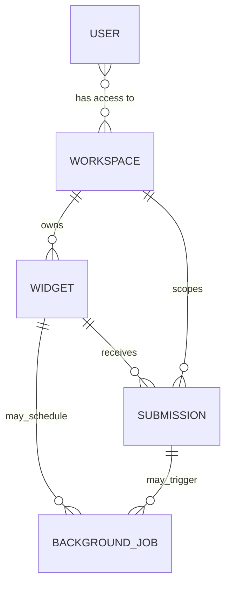
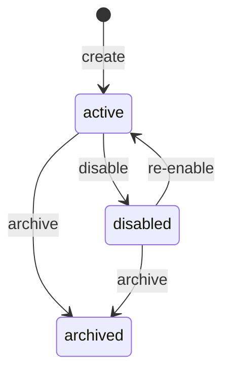
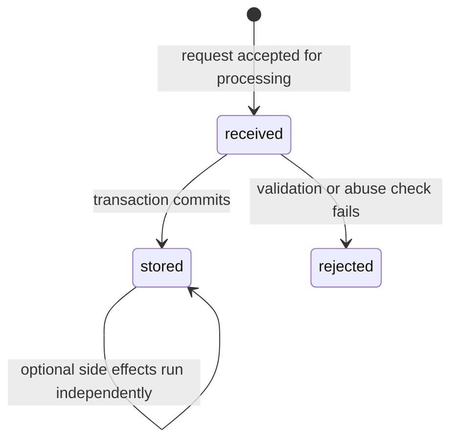

# Domain Models

## 1. Purpose

This document defines the business concepts, relationships, lifecycle rules, and invariants of the **Lead-Capture Platform**, independently of the database schema or HTTP API.

It describes what each entity means and which rules the application must preserve. The physical table layout belongs in `database_schema.md`; request and response shapes belong in `api_contracts.md` and `widget_contract.md`.

> **Implementation status:** These models are the proposed core domain for the capstone. Treat optional fields and features as requirements only when they are implemented and tested. Keep this document synchronized with the actual code.

## 2. Domain overview

The platform lets a person or organization manage lead-capture widgets and collect submissions from external websites.

Core entities:

- **User:** an authenticated person who can access the platform.
- **Workspace:** the tenant boundary that owns widgets and captured submissions.
- **Widget:** a configurable form that can be embedded on a customer website.
- **Submission:** a visitor's attempt to send information through a widget, persisted as a captured lead when accepted.

Supporting concepts may include:

- **Widget configuration:** the validated set of public form settings belonging to a widget.
- **Idempotency record:** metadata used to recognize safe retries and avoid duplicate processing.
- **Background job / delivery record:** durable tracking for asynchronous enrichment, email, or webhook work, if such processing is implemented.

## 3. Entity relationship overview

The user-to-workspace relationship can be one-to-one for a very small first version, but a membership relationship is the more flexible model if users may collaborate in a workspace. The implementation must choose one model explicitly and enforce it consistently.

A submission is associated with both its widget and its workspace. This supports workspace-scoped authorization and avoids relying on the widget identifier alone to determine ownership.

## 4. Core entities

### 4.1 User

**Meaning:** An authenticated platform identity.

**Responsibilities:**
- Represents a person who signs in to manage widgets and review leads.
- Is used by authentication and authorization to determine the caller's identity.
- Gains access to workspace resources through the configured ownership or membership model.

**Typical attributes:**
- `id`: stable internal identifier.
- `email`: normalized email address, if email is the chosen login identifier.
- `display_name`: optional human-readable name.
- `created_at`, `updated_at`: audit timestamps.
- `status`: optional account status, such as active or disabled, if account lifecycle controls are implemented.

**Rules:**
- An unauthenticated visitor submitting a public form is not automatically a platform `User`.
- Login identifiers must be normalized consistently before uniqueness checks.
- A disabled or revoked account must not continue to access protected resources.
- Passwords, password hashes, access tokens and session secrets are credentials, not ordinary profile fields; never expose them through public API responses.
- A user identifier does not, by itself, grant access to every workspace.

### 4.2 Workspace (tenant)

**Meaning:** The tenant and ownership boundary for platform resources.

**Responsibilities:**
- Groups the widgets managed by a customer or organization.
- Defines the scope within which authorized users can view and manage widgets and submissions.
- Provides the boundary for tenant-aware queries, analytics and future usage limits.

**Typical attributes:**
- `id`: stable internal identifier.
- `name`: workspace display name.
- `created_at`, `updated_at`: audit timestamps.
- `status`: optional lifecycle state, if workspace suspension or deletion is supported.

**Rules:**
- Every widget belongs to exactly one workspace.
- Every accepted submission belongs to exactly one workspace and one widget.
- Every workspace-owned read or mutation must verify access to the workspace on the server.
- The backend must not trust a workspace ID supplied by a client without checking the authenticated user's access.
- Workspace scope must be applied to list queries, single-resource lookups, analytics, updates and deletes.
- A workspace's resources must not become accessible to another workspace by guessing an identifier.
- Workspace deletion and retention behavior must be explicitly defined before implementing destructive deletion.

### 4.3 Widget

**Meaning:** A configurable lead-capture form that a workspace can publish on an external website.

**Responsibilities:**
- Defines the fields and public presentation settings for the form.
- Determines whether public configuration can be fetched and submissions can be accepted.
- Connects each submission to the workspace that owns the widget.

**Typical attributes:**
- `id`: internal identifier used by management operations.
- `public_id`: non-secret identifier used by the embed snippet and public endpoints.
- `workspace_id`: owner workspace.
- `name`: internal label used by the workspace.
- `status`: lifecycle state.
- `configuration`: validated configuration for fields and presentation.
- `created_at`, `updated_at`: audit timestamps.
- `version` or `config_version`: optional monotonic version used for cache invalidation, if implemented.

**Rules:**
- A widget belongs to exactly one workspace.
- Its public identifier must be unique within the scope required by the public lookup strategy; globally unique identifiers are simplest for public endpoint lookup.
- The public identifier is not an authentication credential and must not grant management access.
- Only authorized workspace users may create, read, update or delete a widget.
- Public endpoints return only the widget's public configuration.
- Configuration must be validated against an allowlisted schema. Unknown fields and unsafe values must not be blindly reflected into HTML or JavaScript.
- A disabled or archived widget must not accept new submissions.
- Configuration changes must update `updated_at` and, if caching uses versions, advance the configuration version.
- The implementation must define what happens to existing submissions when a widget is disabled, archived or deleted. The recommended default is to preserve accepted submissions unless an explicit retention/deletion policy says otherwise.

#### 4.3.1 Widget configuration

Configuration is a domain value belonging to a widget, not a separate owner or tenant.

Depending on the supported feature set, it may include:
- Form title and submit-button label.
- Field definitions, labels, types and required flags.
- A restricted set of presentation options.
- Allowed website origins or domains, if origin restrictions are part of the product design.
- A success message and safe validation messages.

Configuration rules:
- Field names must be unique within a widget.
- Only supported field types are accepted.
- Required fields must be present and non-empty after normalization.
- Field count, label length, option count and other user-controlled values must have documented bounds.
- Presentation settings must be constrained to safe, supported values rather than arbitrary executable markup or script.
- The server remains authoritative even if the widget performs client-side validation.
- Secrets, provider credentials, private workspace settings and internal-only metadata must never be included in public configuration.

The exact supported fields and limits belong in the widget contract and must match the implementation.

### 4.4 Submission

**Meaning:** A visitor-provided payload accepted and stored by the platform as a lead.

**Responsibilities:**
- Preserves the submitted lead data associated with a specific widget and workspace.
- Records when the submission was received and its processing outcome.
- Provides the source record used by the dashboard, analytics and optional follow-up actions.

**Typical attributes:**
- `id`: stable internal identifier.
- `workspace_id`: workspace owner, stored or derivable through the widget; storing it can simplify safe scoping and reporting.
- `widget_id`: widget that received the submission.
- `data`: validated submitted fields, represented as structured data.
- `created_at`: server-assigned receipt/persistence timestamp.
- `source_origin`: optional, validated origin metadata if required for abuse analysis or reporting.
- `enrichment_status`: optional state if enrichment outcomes are tracked.
- `notification_status`: optional state if notification delivery outcomes are tracked.
- `idempotency_key` or reference: optional retry-deduplication metadata if implemented.

**Rules:**
- A submission must reference an existing widget and its owning workspace.
- The server derives ownership from the resolved widget; it must not trust a visitor-provided `workspace_id`.
- Only fields allowed by the widget configuration may be accepted.
- Input must be validated and normalized on the server, including type, length and total payload-size limits.
- Server-controlled timestamps and identifiers must not be accepted from the visitor as authoritative values.
- A submission must not be rejected solely because optional geolocation, email or webhook delivery fails after the submission has been durably stored.
- Submission data must be visible only to authorized users of the owning workspace.
- Public submission responses must not disclose other leads or internal implementation details.
- Retention, export and deletion rules for lead data must be decided and documented before production use.

## 5. Relationships and ownership

| Relationship | Cardinality | Rule |
|---|---|---|
| User ↔ Workspace | One-to-one or many-to-many through membership | Choose and enforce one access model; membership is recommended if collaboration is expected |
| Workspace → Widget | One-to-many | Every widget has exactly one owner workspace |
| Widget → Submission | One-to-many | A widget can receive many submissions; each submission belongs to one widget |
| Workspace → Submission | One-to-many | Every submission is scoped to its owning workspace |
| Submission → enrichment/notification jobs | Zero-to-many, if jobs are tracked | Jobs refer to the submission they process and must not create a second lead accidentally |

**Ownership invariant:** the workspace attached to a submission must match the workspace that owns its widget. If both `workspace_id` and `widget_id` are stored on a submission, enforce their consistency in application logic and, where practical, with database constraints.

## 6. Entity lifecycle and state transitions

### 6.1 Widget lifecycle

Recommended initial states:

- `active`: public configuration is available and new submissions may be accepted.
- `disabled`: retained for management/history but unavailable for new submissions.
- `archived`: no longer intended for active use; retained for history according to the product's retention policy.

Allowed transitions:

Rules:
- New widgets begin in `active` unless the product explicitly supports drafts.
- Only authorized workspace users can change lifecycle state.
- `disabled` and `archived` widgets reject new public submissions.
- Re-enabling an archived widget is not supported in this initial model; if needed, define it as a deliberate product rule.
- Deletion is separate from archiving and must follow an explicit policy for related submissions and auditability.

### 6.2 Submission lifecycle

A submission record and the work performed after storing it are separate concepts. A captured lead should not disappear or become uncaptured just because an enrichment or notification attempt fails.

At minimum, the submission has a durable existence state: **accepted/stored**. Optional asynchronous tasks can have their own states.

If the application needs an explicit processing status, use a small, well-defined lifecycle such as:

`rejected` describes a request that was not accepted as a stored lead; it should generally be represented in the HTTP result/logging rather than as a normal submission row unless rejected-attempt auditing is deliberately implemented.

Optional enrichment/notification job states may include `pending`, `running`, `succeeded`, `retrying`, and `failed`. These states belong to the job/delivery model, not to the core existence of the submission. Only add them if the implementation persists and exposes those outcomes.

## 7. Business invariants

The following rules must remain true regardless of the API route or database implementation.

### Ownership and access
1. Every widget has one workspace owner.
2. Every submission is associated with one widget and the same owning workspace.
3. A user can access a workspace resource only when authorized for that workspace.
4. Public identifiers never grant management privileges.
5. Tenant scoping is enforced for every protected read and mutation.

### Widget configuration
6. Widget configuration conforms to the supported schema and size limits.
7. Field names are unique within a widget.
8. Public configuration contains no secrets or private management data.
9. Disabled and archived widgets do not accept new submissions.
10. Configuration updates follow the documented version/cache invalidation policy.

### Submission handling
11. The server validates the payload against the widget's current supported fields.
12. The server controls submission identifiers and authoritative timestamps.
13. A submission is considered captured only after durable persistence succeeds.
14. Optional integrations do not undo a successful persistence operation.
15. Retries must not create duplicate leads when the chosen idempotency mechanism promises deduplication.
16. Submitted personal data is accessible only to authorized workspace users and handled under the documented retention policy.

### External dependencies
17. Provider calls have bounded timeouts.
18. Geolocation fallback failure degrades enrichment, not submission capture.
19. Notification/webhook retries, if implemented, are bounded and safe to repeat.
20. Failures are surfaced through documented status, logs or metrics without leaking secrets or lead contents.

## 8. Validation and normalization rules

Validation should occur at the boundary and be enforced again by the application/domain logic where necessary.

- **Identifiers:** parse and validate the expected identifier format; do not infer authorization from an identifier's secrecy.
- **Workspace and widget ownership:** resolve the widget on the server and derive the owning workspace from trusted stored data.
- **Text fields:** trim or normalize according to field semantics; enforce per-field length limits.
- **Email fields:** validate basic syntax when the field is configured as an email field; do not treat syntax validation as proof of mailbox ownership.
- **Optional fields:** allow omission only when the configuration marks the field optional.
- **Unknown fields:** reject or explicitly ignore them according to one consistent, documented API policy; do not persist them silently by default.
- **Payload bounds:** limit request body size, field count, field length and nested structure depth where relevant.
- **Configuration values:** accept only supported field types and presentation options.
- **Timestamps and status:** server-controlled values cannot be overridden by public clients.
- **Origin metadata:** treat `Origin` and similar headers as untrusted input. Use them as one signal in an explicit policy, not as authentication.
- **PII:** avoid copying submitted fields into logs, metrics labels, URLs or error messages.

Exact numeric limits should be set in configuration/API contracts and reflected in tests; this document does not invent numeric limits before implementation decisions are made.

## 9. Identifier conventions

Use consistent identifier semantics across the application.

| Identifier | Purpose | Exposure |
|---|---|---|
| `user_id` | Identifies an authenticated platform user | May appear in authenticated API responses if needed |
| `workspace_id` | Identifies the tenant and resource owner | Authenticated APIs; never trusted without authorization |
| `widget_id` | Internal management identifier for a widget | Authenticated APIs |
| `public_widget_id` | Locates a widget for public configuration and submissions | Intentionally public; not a secret |
| `submission_id` | Identifies a captured lead | Authenticated APIs; avoid exposing more than needed in public responses |
| `job_id` / `delivery_id` | Tracks asynchronous processing, if implemented | Internal or authenticated operational APIs |

Recommended conventions:
- Use one stable identifier format consistently, such as UUIDs, unless a different format is selected deliberately.
- Do not mix numeric IDs, UUIDs and opaque public tokens without a clear reason.
- Keep internal identifiers and public identifiers conceptually distinct even if their physical formats are similar.
- Never treat a UUID or hard-to-guess ID as a substitute for authorization.
- Use server-generated identifiers; clients may provide an idempotency key only through the documented retry contract.
- Include request/correlation IDs in logs for diagnosis, but do not use them as entity identifiers or access credentials.

## 10. Deletion, retention and privacy boundaries

Before production use, define and implement:
- Whether widget deletion is hard delete, soft delete or archive.
- Whether deleting a workspace triggers deletion, export or retention of its submissions.
- How long lead data, logs and failed delivery records are retained.
- Whether users can export or request deletion of submissions.
- Whether geolocation data is stored, at what precision, and for what purpose.
- What information is sent to email, geolocation and webhook providers.

Until those rules are implemented, prefer preserving accepted submissions when disabling or archiving a widget and avoid promising deletion or retention guarantees that the application does not yet enforce.

## 11. Related documentation

- [`architecture.md`](architecture.md) — system components, dependency direction and trust boundaries
- [`database_schema.md`](database_schema.md) — physical tables, constraints and indexes
- [`api_contracts.md`](api_contracts.md) — authenticated API request and response shapes
- [`widget_contract.md`](widget_contract.md) — public widget configuration and submission payload
- [`submission_flow.md`](submission_flow.md) — step-by-step submission processing and failure behavior
- [`security_spec.md`](security_spec.md) — threat scenarios and security controls
- [`event_spec.md`](event_spec.md) — asynchronous job/event payloads and lifecycle, if implemented

---

## Maintenance rule

Update this document whenever an entity, ownership rule, lifecycle transition, validation rule or business invariant changes. Schema details belong in `database_schema.md`; HTTP details belong in the API/widget contracts. If a rule is only planned, mark it as planned until code and tests verify it.
